# Диаграммы исследования

Все графики построены из [единого расчёта](../summary.json). LLM обозначен синим цветом, человек — оранжевым; для групп и языковых уровней используется отдельная легенда.

## NAT

[Все диаграммы раздела в PDF](nat/all_figures.pdf)

### Распределение оценок естественности диалогов

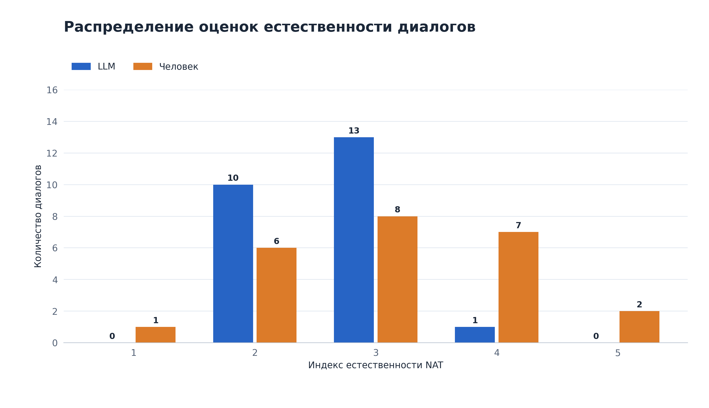

Число диалогов с каждым баллом NAT; по 24 оценки каждого оценщика. [SVG](nat/svg/01_score_distribution.svg).

### Распределение NAT по группам диалогов

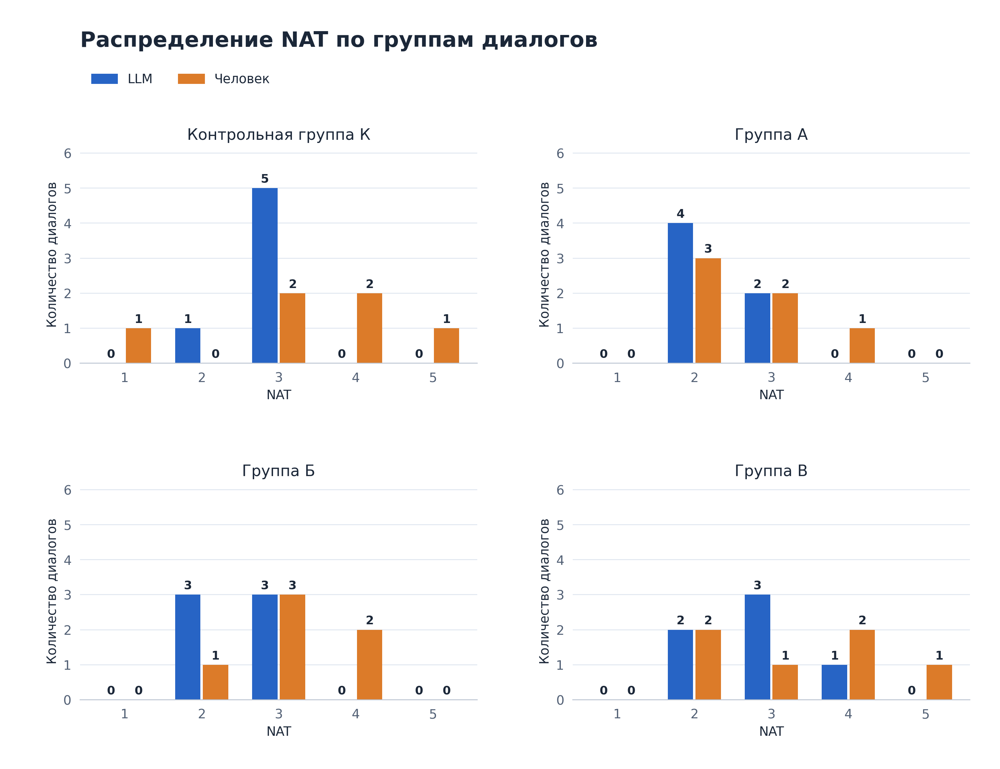

Абсолютные частоты оценок NAT; шесть диалогов в каждой группе. [SVG](nat/svg/02_group_distributions.svg).

### Доли оценок естественности по группам

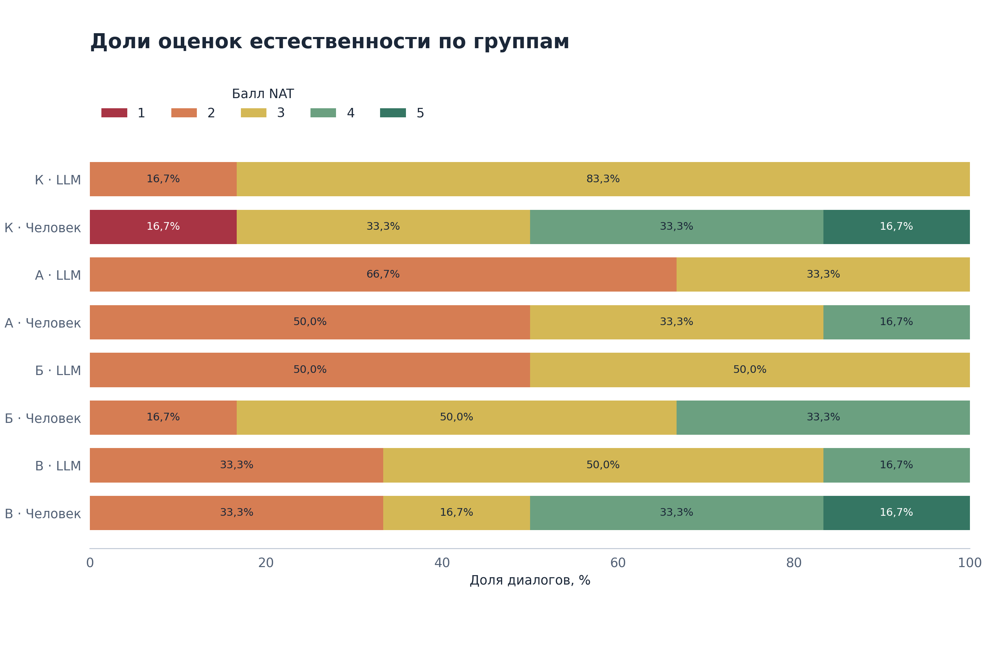

Распределение порядковых баллов; проценты рассчитаны отдельно для каждой группы и оценщика. [SVG](nat/svg/03_group_proportions.svg).

### Совпадения и расхождения оценок NAT

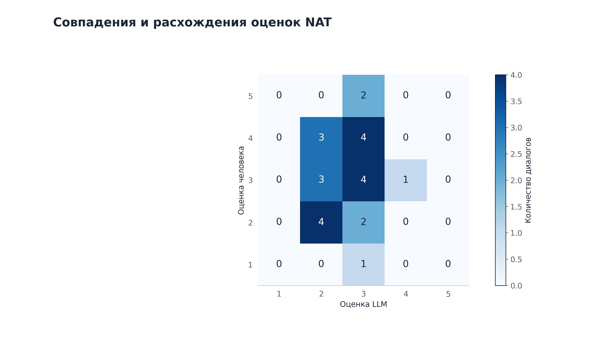

Ячейка показывает число диалогов с соответствующей парой оценок. [SVG](nat/svg/04_agreement_matrix.svg).

### Парные оценки естественности по диалогам

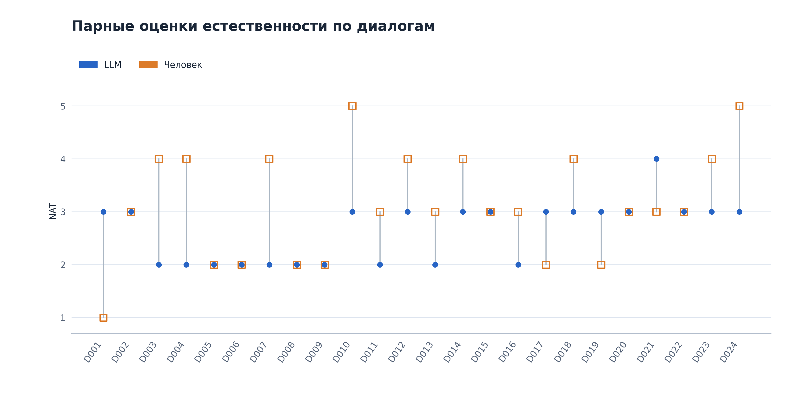

Линия соединяет две оценки одного диалога. Круг — LLM; контурный квадрат — человек. [SVG](nat/svg/05_paired_ratings.svg).

### Разности оценок естественности

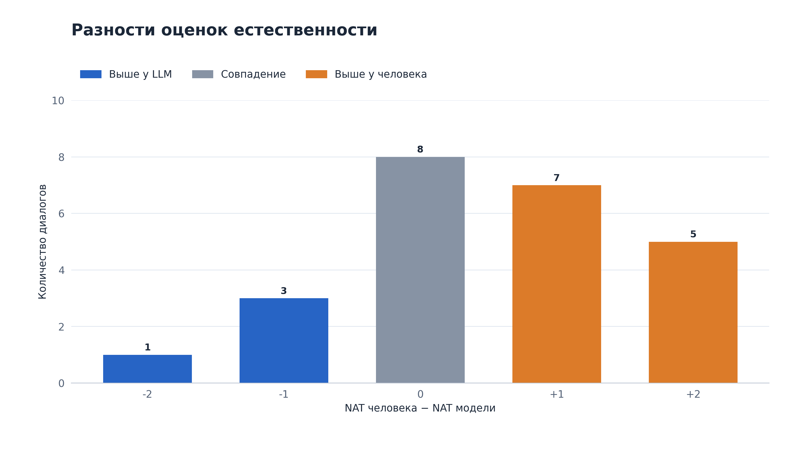

Знак разности отражает направление расхождения; ноль означает точное совпадение. [SVG](nat/svg/06_rating_differences.svg).

### Индивидуальные оценки и медианы NAT

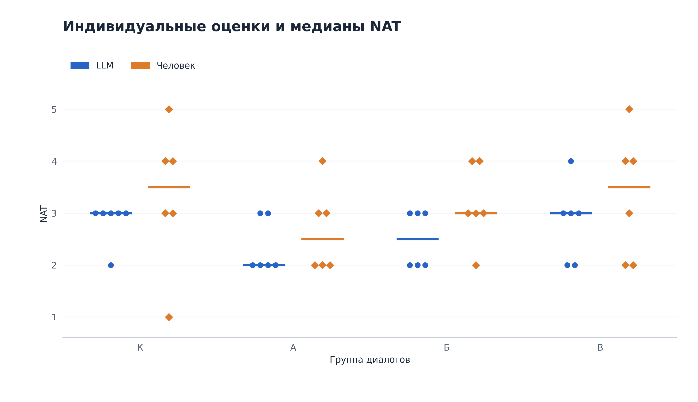

Точки — отдельные диалоги; горизонтальные отрезки — медианы соответствующего оценщика. [SVG](nat/svg/07_observations_and_medians.svg).

### Средняя естественность диалогов по группам

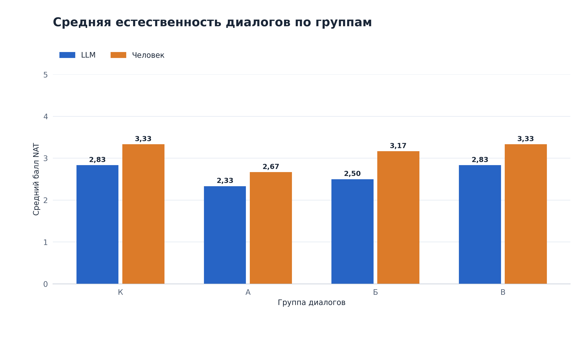

Описательные средние порядковых баллов; вывод о статистической значимости не делается. [SVG](nat/svg/08_group_means.svg).

### Оценки естественности по группам диалогов

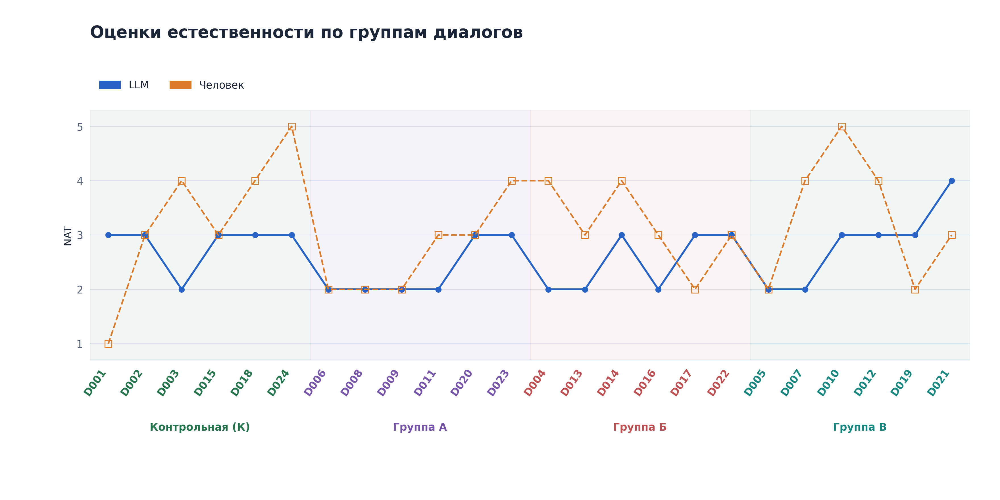

Диалоги упорядочены по группам К, А, Б, В. Цвет подписей обозначает группу; линии — оценщика. [SVG](nat/svg/09_grouped_lines.svg).

## GUILT

[Все диаграммы раздела в PDF](guilt/all_figures.pdf)

### Наличие апелляции к вине по группам

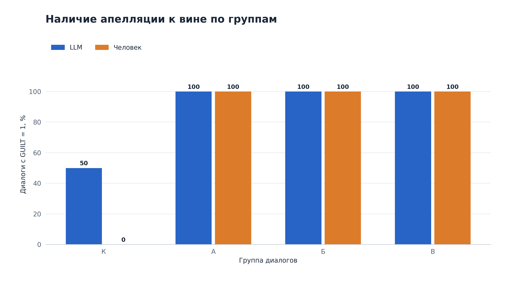

Человеческая метка задана автором по группе; машинная оценка сохранена без подмены эталоном. [SVG](guilt/svg/01_group_comparison.svg).

### Согласованность оценки GUILT с человеческим эталоном

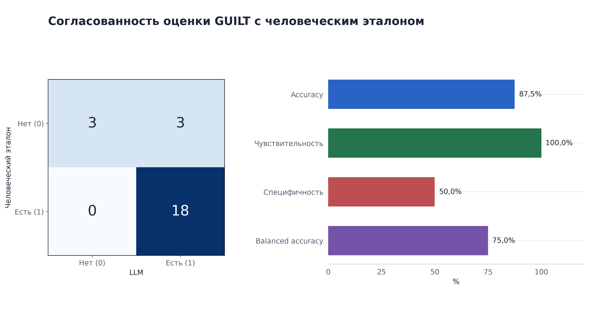

Результаты относительно принятого группового эталона; расхождения: D015, D018, D024. [SVG](guilt/svg/02_confusion_and_performance.svg).

## FLD и FREQ

[Все диаграммы раздела в PDF](fld_freq/all_figures.pdf)

### Разнообразие и частотность средств апелляции к вине

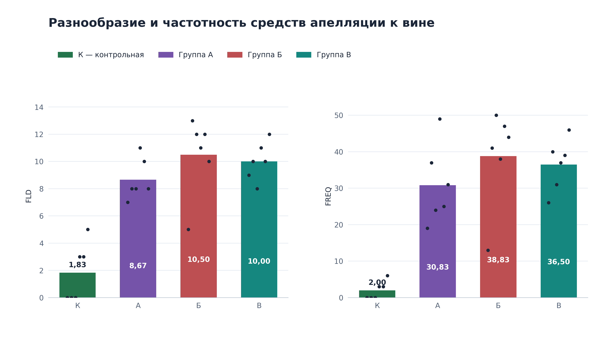

Столбцы — средние, точки — отдельные диалоги. Подсчёт по сохранённым occurrences модели, включая вложенные реализации. [SVG](fld_freq/svg/01_group_means.svg).

### FLD и FREQ по всем диалогам

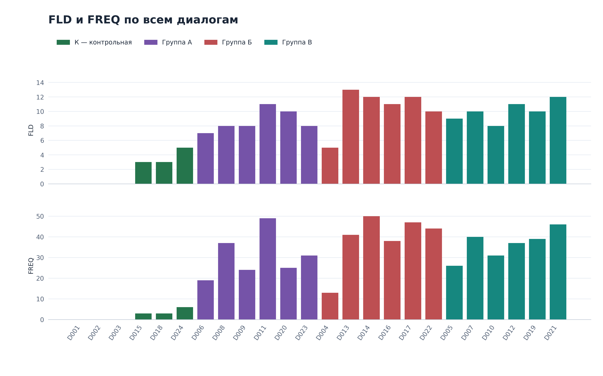

Порядок групп: К, А, Б, В; исходные машинные реализации сохранены и при расхождении по GUILT. [SVG](fld_freq/svg/02_dialogue_metrics.svg).

### Представленность категорий G01–G15

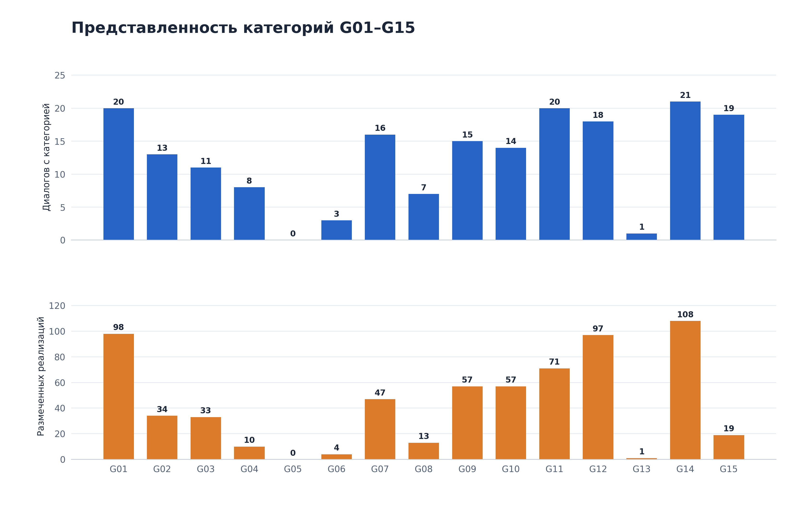

Охват диалогов и количество реализаций — разные единицы; G14 означает речевые акты, G15 — многоходовые последовательности. [SVG](fld_freq/svg/03_category_coverage_and_frequency.svg).

### Языковые уровни в структуре размеченных реализаций

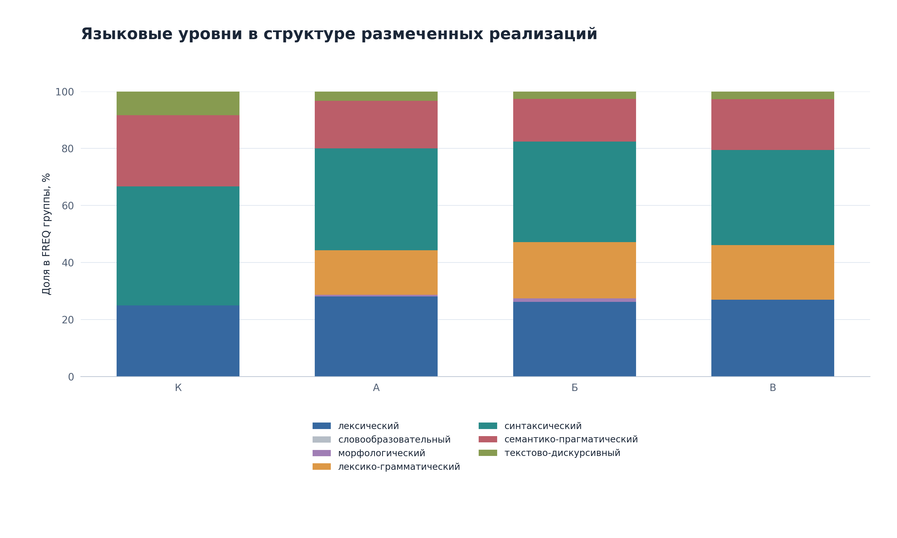

Доли уровней рассчитаны по числу записей occurrences; вложенные коды входят в подсчёт как отдельные реализации. [SVG](fld_freq/svg/04_language_levels.svg).

### Соотношение разнообразия и частотности

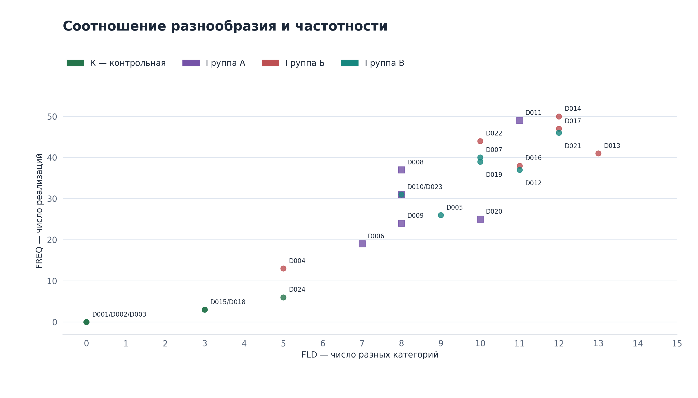

Совпадающие точки подписаны совместно. График показывает описательное соотношение; причинный вывод не делается. [SVG](fld_freq/svg/05_diversity_frequency.svg).

### Средняя частота средств апелляции к вине на 100 слов

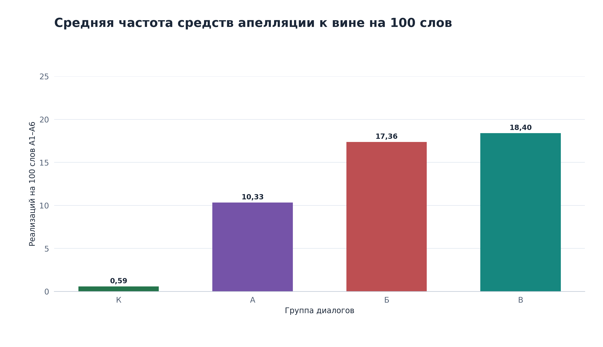

Среднее индивидуальных отношений 100 × FREQ / число слов; не отношение сумм и не общая информационная насыщенность. [SVG](fld_freq/svg/06_frequency_per_100_words.svg).
