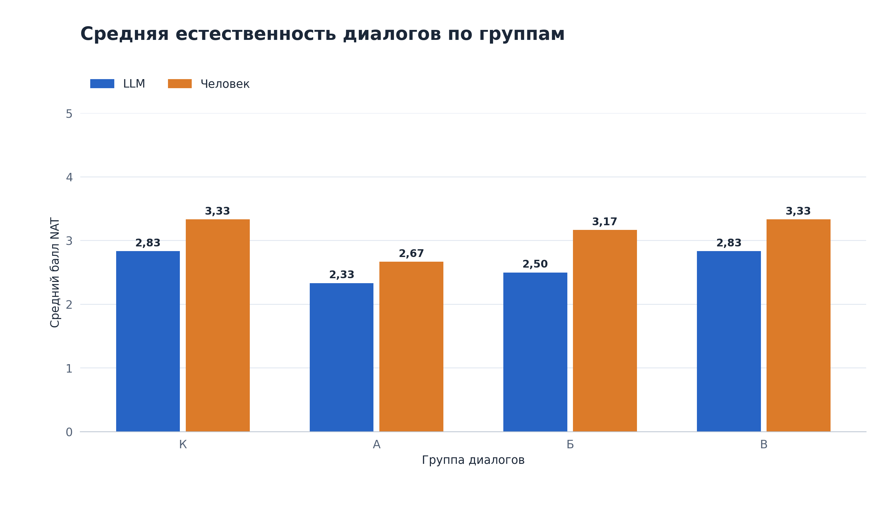

# Апелляция к вине в диалогах больших языковых моделей

Материалы исследования языковых средств апелляции к вине в русскоязычном многоходовом
диалоге. Сопоставляются функциональное определение стратегии, матрица G01–G15,
матрица с речевыми примерами и контрольное условие.

**Состояние на 27.11.2026:** 24 аннотации проверены человеком и имеют `verified`.
Оценки модели, человеческие оценки и расхождения сохранены раздельно.

## Данные исследования

- Исходный пул: 40 диалогов, по 10 в каждой группе.
- Выборка статьи: **D001–D024**, по 6 диалогов в группах К, А, Б и В.
- В выборке 288 реплик B1–B6/A1–A6, из них **144 анализируемых ответа модели**.
- A0 и человеческие реплики используются как контекст и не входят в метрики языковых средств.
- D025–D040 — резерв исходного пула, не аннотирован и не включён в итоговые средние.

| Группа | Условие генерации |
|---|---|
| К | Контрольное взаимодействие |
| А | Функциональное определение апелляции к вине |
| Б | Определение и функционально-лингвистическая матрица |
| В | Определение, матрица и речевые примеры |

## Итоговые показатели

В таблице средние рассчитаны по шести диалогам. GUILT — число положительных меток.
FLD/FREQ вычислены по сохранённым реализациям модели, включая спорные контрольные случаи.

| Группа | n | FLD | FREQ | FREQ / 100 слов | NAT LLM | NAT человека | GUILT LLM / человек |
|---|---:|---:|---:|---:|---:|---:|---|
| К | 6 | 1,83 | 2,00 | 0,59 | 2,83 | 3,33 | 3 / 0 |
| А | 6 | 8,67 | 30,83 | 10,33 | 2,33 | 2,67 | 6 / 6 |
| Б | 6 | 10,50 | 38,83 | 17,36 | 2,50 | 3,17 | 6 / 6 |
| В | 6 | 10,00 | 36,50 | 18,40 | 2,83 | 3,33 | 6 / 6 |

Всего сохранено **649 реализаций**. Средняя NAT —
**2,62 у LLM** и **3,12 у человека**.
По GUILT совпали 21 из 24 решений; расхождения — **D015, D018, D024**.
Accuracy = 87,5%, чувствительность = 100%,
специфичность = 50%, balanced accuracy = 75% относительно принятого человеческого эталона.

Человеческая метка GUILT задана автором по группе. Это основание сравнения,
а не документированная независимая слепая экспертиза каждого фрагмента.
`verified` означает проверку человеком и не подменяет ошибочные решения модели правильными.

## Диаграммы и расчёты

- [Все 17 диаграмм с подписями и легендами](06_results/figures/README.md):
  NAT — 9, GUILT — 2, FLD/FREQ — 6; PNG, SVG и PDF-сборники.
- [Показатели по каждому диалогу](06_results/dialogue_metrics.csv),
  [сводка групп](06_results/group_summary.csv), [полный расчёт JSON](06_results/summary.json).
- [Аналитическое описание](06_results/analysis.md) и [проверка результатов](06_results/validation_report.json).
- [Соответствие рисункам статьи](04_protocol/article_figure_mapping.md).



## Структура

| Путь | Содержание |
|---|---|
| `01_original/` | Неизменённые DOCX, по десять диалогов в каждом |
| `02_corpus/` | Анонимные тексты D001–D040 |
| `03_prompts/` | Сохранённые варианты промптов и инструкция аннотации |
| `04_protocol/` | Методика, схемы, выборка, происхождение и журнал проверки |
| `05_annotations/` | 24 аннотации и отдельный источник NAT человека |
| `06_results/` | Итоговые таблицы, JSON, диаграммы и аналитические материалы |
| `07_scripts/` | Переносимые проверки, расчёт и построение диаграмм |
| `tests/` | Проверки существенных правил учёта |
| `dialogue_registry.csv` | Основная связь ID, группы и исходного номера |

## Воспроизведение

Python 3.11; команды выполняются из корня проекта после активации виртуальной среды.

```bash
python -m pip install -r requirements.lock.txt
python 07_scripts/reproduce.py
```

Для проверки сохранённых изображений без повторного рендеринга:

```bash
python 07_scripts/reproduce.py --no-figures
```

Расчёт локальный, без API и повторной генерации диалогов.
Подробности: [REPRODUCIBILITY.md](REPRODUCIBILITY.md),
[единицы и поля данных](DATA_DICTIONARY.md), [протокол](04_protocol/experiment_protocol.md).

## Ограничения и подготовка публикации

Основные ограничения: небольшой корпус, одна коммуникативная ситуация, фиксированные
человеческие ходы, неоднородная гранулярность части разметок и отсутствие точных
идентификаторов исторических запусков. Сравнение описательное, без проверки
статистической значимости межгрупповых различий и без измерения эффективности убеждения.

Для публикации остаются авторские сведения: точный контрольный промпт К, версии и параметры
моделей, индивидуальные оценки оценщиков, библиографические данные и лицензии.
[Полный перечень](04_protocol/data_gaps.md). Эти сведения не выдумывались при оформлении.

История правил находится в `04_protocol/legacy/`; прежние DOCX-отчёты —
в `06_results/reports/history/`. Актуальные источники показателей — аннотации,
человеческие оценки и `06_results/summary.json`.
